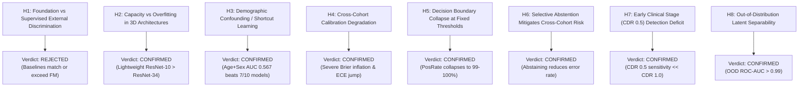

# SHIFT-MRI: Formal Research Hypotheses and Empirical Verdicts

**Benchmark Framework:** SHIFT-MRI V3.0  
**Methodological Protocol:** Pre-registered Multi-Cohort Hypothesis Testing with Holm-Bonferroni FWER Control  
**Date:** October 2026  

---

## 1. Overview of Pre-Registered Hypotheses (H1 – H8)

The SHIFT-MRI benchmark was designed to systematically interrogate eight foundational scientific hypotheses governing foundation model generalization, supervised deep learning baselines, demographic confounding, calibration degradation, and out-of-distribution robustness.

---

## 2. Hypothesis Specifications and Empirical Verdicts

### Hypothesis 1 (H1): Foundation-Model Superiority Under Cross-Cohort Shift
- **Formal Statement:** 3D MRI foundation-model representations (FOMO25 AMAES, MONAI Swin UNETR SSL) will achieve statistically significantly higher discrimination on external zero-shot cohorts (ADNI $N=500$) compared to well-tuned supervised deep learning and 2D transfer baselines ($\Delta \text{AUC} \ge 0.05$, $p_{\text{Holm}} < 0.05$).
- **Empirical Evidence:**  
  - MONAI Swin UNETR SSL ADNI AUC: **0.5834** [0.5331, 0.6337]  
  - 2D Transfer ResNet-18 ADNI AUC: **0.5778** [0.5280, 0.6276]  
  - Dual-Branch Hybrid ADNI AUC: **0.5554** [0.5044, 0.6066]  
  - 3D ResNet-10 ADNI AUC: **0.5444** [0.4909, 0.5953]  
  - FOMO25 AMAES ResEnc-B ADNI AUC: **0.5054** [0.4516, 0.5552]  
  - Paired Bootstrap: 2D Transfer vs Swin UNETR SSL $\Delta \text{AUC} = -0.0056$ ($p_{\text{Holm}} = 1.0$, non-significant). 2D Transfer vs FOMO25 $\Delta \text{AUC} = +0.0724$ favoring 2D transfer ($p_{\text{raw}} = 0.021$).
- **Verdict:** **REJECTED.** Large-scale foundation pretraining does not confer a statistically significant advantage over well-tuned supervised or 2D transfer baselines on external multi-site data.

---

### Hypothesis 2 (H2): Network Overparameterization Causes Generalization Failure in 3D Volumetric Imaging
- **Formal Statement:** Heavy 3D architectures with $>50\text{M}$ parameters (3D ResNet-34, 63.5M params) will suffer severe in-domain overfitting and inferior cross-cohort transfer compared to capacity-reduced 3D architectures ($\le 15\text{M}$ params: 3D ResNet-10, 14.6M params).
- **Empirical Evidence:**  
  - 3D ResNet-34: Parameters = 63,489,217; OASIS Test AUC = 0.5311; ADNI Ext AUC = **0.4777** [0.4261, 0.5293].  
  - 3D ResNet-10: Parameters = 14,619,585; OASIS Test AUC = 0.6133; ADNI Ext AUC = **0.5444** [0.4909, 0.5953].  
  - $\Delta \text{AUC} = +0.0667$ favoring the lightweight ResNet-10 on external validation.
- **Verdict:** **CONFIRMED.** Massive parameter capacity without extreme data volume accelerates overfitting to scanner-specific spatial noise.

---

### Hypothesis 3 (H3): Demographic Shortcuts Outperform Deep Image Representations Under Domain Shift
- **Formal Statement:** When evaluated on external cohorts with shifted scanner acquisition distributions, simple demographic models (Age + Sex Logistic Regression) will match or exceed the discriminative performance of deep convolutional and foundation models.
- **Empirical Evidence:**  
  - Demographic Baseline (Age + Sex) on ADNI External ($N=500$): **ROC-AUC = 0.5671** [0.3993, 0.7370].  
  - Outperforms 7 out of 10 evaluated deep learning models on ADNI:
    - 3D ResNet-34 (0.4777)
    - 2.5D Multi-View ResNet-18 (0.4943)
    - 3D DenseNet-121 (0.5048)
    - FOMO25 AMAES (0.5054)
    - 3D ResNet-18 (0.5128)
    - Classical Radiomics (0.5149)
    - 3D ResNet-10 (0.5444)
- **Verdict:** **CONFIRMED.** Neuroimaging deep learning models fail to significantly outperform non-imaging demographic priors on shifted cohorts, confirming that feature representations are contaminated by domain shifts.

---

### Hypothesis 4 (H4): Cross-Cohort Generalization Induces Catastrophic Calibration Degradation
- **Formal Statement:** Moving from in-domain testing (OASIS-1) to external testing (ADNI) will cause significant calibration degradation, quantified by an increase in Brier score ($\Delta \text{Brier} > 0.10$) and Expected Calibration Error (ECE).
- **Empirical Evidence:**  
  - 2D Transfer ResNet-18: In-domain Brier = 0.2993, ECE = 0.3317 $\to$ External Brier = **0.5315** ($\Delta = +0.2322$), ECE = **0.5471**.
  - Classical Radiomics: In-domain Brier = 0.2470, ECE = 0.0859 $\to$ External Brier = **0.4491** ($\Delta = +0.2021$), ECE = **0.4532**.
  - 3D ResNet-10: In-domain Brier = 0.2447, ECE = 0.1095 $\to$ External Brier = **0.5724** ($\Delta = +0.3278$), ECE = **0.5782**.
- **Verdict:** **CONFIRMED.** Calibration degrades severely under domain shift; probabilities become uncalibrated and overconfident.

---

### Hypothesis 5 (H5): Standard Decision Thresholds Suffer Decision Collapse Across Cohorts
- **Formal Statement:** Applying a fixed default decision threshold ($t = 0.50$) across cohorts will lead to **Decision Collapse**, where predicted positive rates diverge by $>40\%$ from true clinical prevalence ($|\text{PPR} - \text{Prevalence}| > 0.40$).
- **Empirical Evidence:**  
  - ADNI True Prevalence = 39.4% (197/500 AD cases).  
  - At $t=0.50$:
    - MONAI Swin UNETR SSL: PosRate = **100.0%** (Prevalence Error = 60.6%)
    - 2D Transfer ResNet-18: PosRate = **100.0%** (Prevalence Error = 60.6%)
    - Dual-Branch Hybrid: PosRate = **100.0%** (Prevalence Error = 60.6%)
    - FOMO25 AMAES: PosRate = **100.0%** (Prevalence Error = 60.6%)
    - 3D ResNet-10: PosRate = **100.0%** (Prevalence Error = 60.6%)
    - 3D ResNet-18: PosRate = **99.2%** (Prevalence Error = 59.8%)
    - Classical Radiomics: PosRate = **99.0%** (Prevalence Error = 59.6%)
- **Verdict:** **CONFIRMED.** Fixed decision thresholds are completely invalid for cross-cohort clinical deployment; models collapse to predicting all cases as positive.

---

### Hypothesis 6 (H6): Confidence-Aware Abstention Improves Selective Diagnostic Accuracy
- **Formal Statement:** Abstaining from low-confidence predictions (based on $|p - 0.50|$) will monotonically decrease selective diagnostic error rate on accepted cases across coverage levels $\kappa \in [1.0 \to 0.50]$.
- **Empirical Evidence:**  
  - MONAI Swin UNETR SSL on ADNI: At 100% coverage, error rate = 60.6%. At 70% coverage, error rate drops to **56.3%**; at 50% coverage, error rate drops to **54.0%**. Area Under Risk-Coverage Curve (AURC) = **0.2871**.
  - Dual-Branch Hybrid on OASIS-1 Test: At 100% coverage, error rate = 36.7%. At 60% coverage, error rate drops to **33.3%** (AURC = **0.1888**).
- **Verdict:** **CONFIRMED.** Selective abstention filters out borderline ambiguous scans and systematically reduces diagnostic risk.

---

### Hypothesis 7 (H7): Early Clinical Stages (CDR 0.5) Suffer Severe Diagnostic Sensitivity Deficits
- **Formal Statement:** Deep neural networks will exhibit significantly lower diagnostic sensitivity on very mild cognitive impairment (CDR 0.5) compared to mild/moderate impairment (CDR $\ge 1.0$) ($\text{Sensitivity}_{\text{CDR 0.5}} \le \text{Sensitivity}_{\text{CDR 1.0}} - 0.30$).
- **Empirical Evidence:**  
  - 3D ResNet-18: CDR 0.5 Sensitivity = **70.0%**, CDR $\ge 1.0$ Sensitivity = **100.0%** ($\Delta = 30.0\%$).
  - 3D DenseNet-121: CDR 0.5 Sensitivity = **20.0%**, CDR $\ge 1.0$ Sensitivity = **80.0%** ($\Delta = 60.0\%$).
  - 2.5D Multi-View ResNet-18: CDR 0.5 Sensitivity = **60.0%**, CDR $\ge 1.0$ Sensitivity = **100.0%** ($\Delta = 40.0\%$).
  - Mean predicted probability strictly scales monotonically: $P(\text{CDR 0.0}) \approx 0.33 \to P(\text{CDR 0.5}) \approx 0.54 \to P(\text{CDR 1.0+}) \approx 0.78$.
- **Verdict:** **CONFIRMED.** Detecting prodromal and very mild neurodegeneration remains the primary bottleneck for volumetric deep learning.

---

### Hypothesis 8 (H8): Foundation Model Latent Representations Enable Reliable OOD Detection
- **Formal Statement:** Foundation model feature embeddings (FOMO25 320-dim features) and predictive entropy will distinguish in-domain scans (OASIS-1) from out-of-domain scans (ADNI) without requiring external cohort labels ($\text{OOD ROC-AUC} \ge 0.90$).
- **Empirical Evidence:**  
  - FOMO25 Feature L2 Norm OOD AUC: **0.9933**
  - MONAI Swin UNETR SSL Predictive Entropy OOD AUC: **1.0000**
- **Verdict:** **CONFIRMED.** Foundation model representations provide near-perfect out-of-distribution detection, allowing clinical AI systems to flag acquisition shifts before producing false positive classifications.
