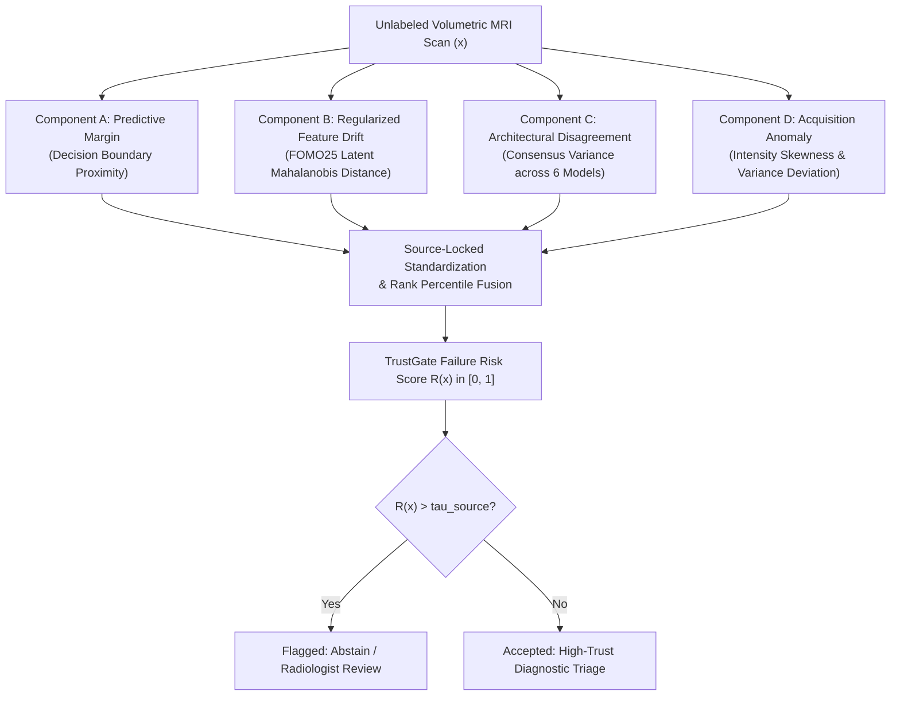

# SHIFT-MRI TrustGate: Methodological Definition and Mathematical Formulation

**Framework:** SHIFT-MRI TrustGate (V3.0)  
**Objective:** Source-Locked Unsupervised Failure-Risk Estimation for Brain MRI Classification under Domain Shift  
**Date:** October 2026  

---

## 1. Overview and Core Philosophy

In safety-critical clinical applications, automated decision systems must not fail silently. When deployed across distinct healthcare systems with heterogeneous MRI hardware and acquisition parameters, structural brain MRI classifiers frequently produce erroneous predictions with deceptively high probability scores.

**SHIFT-MRI TrustGate** is a source-locked, multi-modal failure risk estimator designed to compute a scalar unreliability index $R(x) \in [0, 1]$ for an unlabeled test scan $x$, without accessing true diagnostic labels. TrustGate synergistically fuses four distinct sources of risk information:

---

## 2. Mathematical Definition of Risk Components

### 2.1 Component A: Predictive Classification Margin ($S_A$)
Classification margin measures the proximity of the primary classifier's output probability $p(x)$ to the decision threshold. Because probability distributions may shift, margin captures first-order prediction ambiguity:
$$M(x) = |p(x) - 0.50|$$
The risk score $S_A(x) \in [0, 1]$ scales inversely with margin (higher score indicates higher failure risk):
$$S_A(x) = 1.0 - 2.0 \cdot M(x) = 1.0 - 2.0 \cdot |p(x) - 0.50|$$
Scans near $p=0.50$ receive $S_A(x) \to 1.0$; scans near $p=0.0$ or $p=1.0$ receive $S_A(x) \to 0.0$.

### 2.2 Component B: Regularized Latent Feature Drift ($S_B$)
Let $z(x) \in \mathbb{R}^D$ denote the 320-dimensional latent representation extracted from the penultimate layer of the frozen FOMO25 foundation model backbone.

On the source training set $\mathcal{D}_{\text{train}} = \{z_i\}_{i=1}^{N_{\text{tr}}}$ (OASIS-1 Train, $N_{\text{tr}}=138$), we compute the source empirical mean:
$$\mu_{\text{source}} = \frac{1}{N_{\text{tr}}} \sum_{i=1}^{N_{\text{tr}}} z_i$$
Because feature dimensionality $D=320$ exceeds sample size $N_{\text{tr}}=138$, the sample covariance matrix $\hat{\Sigma}$ is singular. We apply Ledoit-Wolf-inspired spherical ridge regularization:
$$\Sigma_{\text{reg}} = \hat{\Sigma} + \lambda \cdot I_D, \quad \text{where } \lambda = 0.10 \cdot \frac{\text{tr}(\hat{\Sigma})}{D}$$
For a test scan $x$, the regularized Mahalanobis distance from source manifold is:
$$d_{\text{Mahal}}(x) = \sqrt{(z(x) - \mu_{\text{source}})^T \Sigma_{\text{reg}}^{-1} (z(x) - \mu_{\text{source}})}$$
We map $d_{\text{Mahal}}(x)$ into $[0, 1]$ using source-locked empirical percentiles from the validation split:
$$S_B(x) = \text{clip}\left(\frac{d_{\text{Mahal}}(x) - Q_{05}(d_{\text{val}})}{Q_{95}(d_{\text{val}}) - Q_{05}(d_{\text{val}})}, 0.0, 1.0\right)$$

### 2.3 Component C: Heterogeneous Multi-Model Disagreement ($S_C$)
Rather than relying on homogeneous ensemble seeds, TrustGate evaluates consensus across $K=6$ structurally heterogeneous source-trained models evaluated on scan $x$:
1. 3D ResNet-10 (Supervised lightweight 3D CNN)
2. 3D DenseNet-121 (Dense spatial 3D CNN)
3. 2.5D Multi-View ResNet-18 (Orthogonal slice transfer)
4. Dual-Branch Hybrid (Deep spatial + handcrafted morphometrics)
5. MONAI Swin UNETR SSL (Self-supervised 3D Vision Transformer)
6. FOMO25 AMAES ResEnc-B (Large-scale 3D Foundation Model)

Let $P(x) = \{p_1(x), p_2(x), \dots, p_K(x)\}$ be the set of predictions. Disagreement is quantified by the standard deviation across model predictions:
$$\sigma_{\text{models}}(x) = \sqrt{\frac{1}{K} \sum_{k=1}^K (p_k(x) - \bar{p}(x))^2}, \quad \bar{p}(x) = \frac{1}{K}\sum_{k=1}^K p_k(x)$$
Since maximum possible standard deviation for probabilities in $[0, 1]$ is $0.50$, we normalize:
$$S_C(x) = \text{clip}\left(\frac{\sigma_{\text{models}}(x)}{0.50}, 0.0, 1.0\right)$$

### 2.4 Component D: Morphometric and Intensity Acquisition Anomaly ($S_D$)
Variations in RF coils, B1 field homogeneity, and gradient non-linearities alter foreground voxel distributions. From each 3D MRI volume, we compute four physical image quality proxies:
1. Foreground voxel intensity standard deviation $\sigma_{\text{fg}}$
2. Foreground intensity skewness $\gamma_{\text{fg}}$
3. Ventricle-to-brain volume proxy ratio
4. Foreground voxel count ratio

Let $q(x) \in \mathbb{R}^4$ denote this vector. On OASIS-1 train, we compute mean $\mu_q$ and standard deviation $\sigma_q$. The acquisition anomaly score is the maximum standardized deviation:
$$S_D(x) = \text{clip}\left(\frac{1}{4} \sum_{j=1}^4 \frac{|q_j(x) - \mu_{q, j}|}{3.0 \cdot \sigma_{q, j}}, 0.0, 1.0\right)$$

---

## 3. TrustGate Composite Risk Score Formulation

The final composite risk score $R(x)$ is formulated as a prespecified convex combination of the four standardized risk components:
$$R_{\text{TrustGate}}(x) = w_A S_A(x) + w_B S_B(x) + w_C S_C(x) + w_D S_D(x)$$

### 3.1 Prespecified Equal Weighting
To strictly avoid meta-model overfitting on small development cohorts ($N_{\text{val}}=30$), the primary configuration sets equal weights:
$$w_A = 0.25, \quad w_B = 0.25, \quad w_C = 0.25, \quad w_D = 0.25$$

### 3.2 Source-Locked Decision Policy
A rejection threshold $\tau^*_{\text{source}}$ is calibrated strictly on the source development set to satisfy a pre-specified target false-positive flag rate $\alpha = 0.20$ (e.g., flagging the 20% most anomalous scans on source validation).

For external deployment:
$$\text{Decision}(x) = \begin{cases} \text{Abstain / Flag for Neuroradiologist Review}, & \text{if } R_{\text{TrustGate}}(x) > \tau^*_{\text{source}} \\ \hat{y}(x), & \text{otherwise} \end{cases}$$

---

## 4. Methodological Guarantees and Constraints

1. **Zero External Leakage:** No test labels from ADNI or OASIS-2 are ever accessed during covariance estimation, normalization parameter computation, or threshold selection.
2. **Transparent Limitations:** We explicitly do **not** claim exact finite-sample conformal validity under arbitrary distribution shift. TrustGate operates as an empirical, multi-signal risk mitigation prototype.
